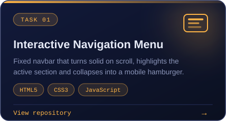
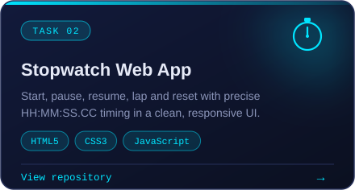
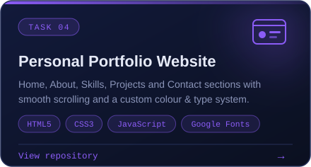
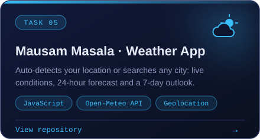

<div align="center">



<br/>

<a href="https://github.com/Peehu-Patel"></a>
&nbsp;
<a href="https://www.linkedin.com/in/peehu-patel-7b23b23b7"></a>
&nbsp;
<a href="mailto:peehupatel99@gmail.com"></a>

<br/><br/>


</div>


<div align="center">

</div>

<br/>

I'm a **web developer** who enjoys turning ideas into clean, responsive and interactive interfaces. I build with **HTML, CSS and vanilla JavaScript**, and I care about the details: smooth interactions, readable code and layouts that feel right on every screen size.

Through the **Prodigy InfoTech Web Development Internship** I've shipped a navigation system, a stopwatch, a personal portfolio and a live weather app that talks to a real API. Each one taught me something new about structuring code, handling browser APIs and polishing the user experience.

<div align="center">

</div>


<div align="center">

</div>

<div align="center">

</div>


<div align="center">
<table>
  <tr>
    <td align="center">
      <a href="https://github.com/Peehu-Patel/PRODIGY_WD_01"></a>
    </td>
    <td align="center">
      <a href="https://github.com/Peehu-Patel/PRODIGY_WD_02"></a>
    </td>
  </tr>
  <tr>
    <td align="center">
      <a href="https://github.com/Peehu-Patel/PRODIGY_WD_04"></a>
    </td>
    <td align="center">
      <a href="https://github.com/Peehu-Patel/PRODIGY_WD_05"></a>
    </td>
  </tr>
</table>
</div>

<br/>

<details>
<summary><b>Navigation Menu: what's inside</b></summary>
<br/>

- Fixed navbar that stays visible on every scroll position
- Switches from transparent to solid orange with a shadow after scrolling past **50px**
- Animated underline and colour change on hover
- **Active section** is highlighted automatically while scrolling
- Mobile hamburger menu for small screens
- Distinct pastel background per section for visual clarity

```
nav-project/
├── index.html
├── style.css
└── script.js
```

[Open the repository](https://github.com/Peehu-Patel/PRODIGY_WD_01)

</details>

<details>
<summary><b>Stopwatch: what's inside</b></summary>
<br/>

- Start, pause and resume the timer
- Record **lap times**
- Reset in one click
- Time displayed as `HH:MM:SS.CC`
- Clean, responsive UI

[Open the repository](https://github.com/Peehu-Patel/PRODIGY_WD_02)

</details>

<details>
<summary><b>Portfolio Website: what's inside</b></summary>
<br/>

- Five sections: **Home, About, Skills, Projects, Contact**
- Fully responsive across mobile, tablet and desktop
- Smooth-scroll navigation and an interactive contact form
- Custom colour and type system using **Fraunces**, **Sora** and **JetBrains Mono**

```
portfolio-website/
├── index.html
├── style.css
├── script.js
└── assets/
```

[Open the repository](https://github.com/Peehu-Patel/PRODIGY_WD_04)

</details>

<details>
<summary><b>Mausam Masala (Weather App): how it works</b></summary>
<br/>

```
Geolocation API  ──▶  Open-Meteo Forecast API  ──▶  Reverse Geocoding  ──▶  UI
      │                                                                      ▲
      └──── or: city search ──▶ Geocoding API ──▶ coordinates ───────────────┘
```

- Detects your location on load (with permission) or searches any city worldwide
- Temperature, "feels like", conditions, wind, humidity, precipitation and UV index
- **24-hour** hourly forecast and a **7-day** outlook
- Weather codes mapped to readable descriptions and emoji icons
- Friendly error handling when location is denied or a city isn't found
- Uses the free [Open-Meteo API](https://open-meteo.com/) (no API key needed)

[Open the repository](https://github.com/Peehu-Patel/PRODIGY_WD_05)

</details>

<div align="center">

</div>


<div align="center">

</div>

<div align="center">

</div>


<div align="center">

</div>

<div align="center">

</div>


| Stage | Focus | Topics |
| :-- | :-- | :-- |
| **Now** | Strong front-end fundamentals | Semantic HTML, modern CSS layouts, ES6+ JavaScript, DOM and browser APIs, responsive design |
| **Building** | Data-driven interfaces | Fetch and async/await, REST APIs, error handling, accessibility, performance |
| **Next** | Frameworks and full-stack | React, Node.js, TypeScript, databases, deployment pipelines |

<div align="center">

</div>


I'm always happy to talk about web development, collaborate on small projects or hear about internship and junior developer opportunities.

<div align="center">

<a href="https://www.linkedin.com/in/peehu-patel-7b23b23b7"></a>
&nbsp;
<a href="mailto:peehupatel99@gmail.com"></a>

<br/>


</div>
